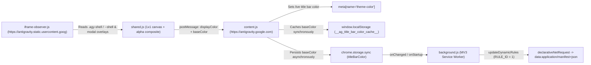

# Technical Documentation — Title Bar Theme for Google Antigravity

Architecture, cross-origin theme and modal scrim compositing, PWA manifest redirection, permission boundaries, and Chrome Web Store packaging across [`manifest.json`](../manifest.json), [`source/shared.js`](../source/shared.js), [`source/iframe-observer.js`](../source/iframe-observer.js), [`source/content.js`](../source/content.js), [`source/background.js`](../source/background.js), and [`build.ps1`](../build.ps1).

## 1. Architecture & Repository Layout

```text
chrome-extension-theme-for-antigravity/
├── .gitignore                        # Ignores package/, *.zip, *.crx, *.pem, *.htmd
├── assets/
│   ├── icon16.png                    # Toolbar and extension icons
│   ├── icon48.png
│   ├── icon128.png                   # Chrome Web Store listing icon
│   └── screenshot-1280x800.png       # Chrome Web Store & README preview screenshot (excluded from .zip)
├── docs/
│   ├── privacy.md                    # Zero-collection privacy policy
│   └── technical.md                  # Cross-origin architecture, color math & packaging reference
├── source/
│   ├── background.js                 # MV3 service worker: declarativeNetRequest redirect & tab re-injection
│   ├── content.js                    # Top-level frame controller: zero-flash cache & meta lock
│   ├── iframe-observer.js            # Cross-origin iframe observer: --shell & modal scrim detector
│   └── shared.js                     # Shared guards, 1x1 canvas CSS color resolver, alpha blender & meta helper
├── build.ps1                         # Validates manifest paths and packages package\<repo>-v<ver>.zip
├── manifest.json                     # Extension Manifest V3 (kept at root for Load unpacked)
└── readme.md                         # User-facing overview, preview, installation & companion links
```

**Why `manifest.json` stays at the repository root:** Chrome's `chrome://extensions` **Load unpacked** flow requires `manifest.json` directly inside the selected directory and disallows `../` parent path traversal in extension resource URLs. Keeping [`manifest.json`](../manifest.json) at the root allows developer-mode loading directly from a git checkout while keeping scripts under `source/`, images under `assets/`, and documentation under `docs/`.



## 2. Design Constraints & Rationale

On Windows, Chromium drives a standalone PWA window frame and launch screen from two independent sources: a `<meta name="theme-color">` element in the top-level document `<head>` for the live window title bar (tags inside nested `<iframe>` elements are ignored), and the Web App Manifest (`theme_color` and `background_color` in `/assets/manifest.json`) fetched before any page script executes for the cold-launch splash screen.

Four behaviors on `https://antigravity.google.com/` prevent a single-frame script from keeping both synchronized:

1. **Static `#1f1f1f` Outer Shell & Manifest:** The outer host HTML (`<meta name="theme-color" content="#1f1f1f">`) and `/assets/manifest.json` hardcode dark gray regardless of the user's workspace appearance.
2. **Cross-Origin Workspace Iframe (`https://antigravity.static.usercontent.goog/*`):** `.agy-shell`, `--shell`, custom Appearance presets, and Settings modals live inside a sandboxed cross-origin `<iframe>`. Browser Same-Origin Policy blocks top-level scripts from reading iframe styles and blocks iframe scripts from editing top-level `<head>` tags.
3. **CSS Color 4 & Translucent Modal Scrims:** Workspace surfaces and overlays use CSS Color 4 syntax (`oklab(...)`, `color(srgb ...)`) and semi-transparent backdrops (`~0.3` alpha scrims). Chromium's native frame requires an opaque sRGB `#rrggbb` hex value, so translucent scrims must be rasterized and alpha-blended onto the underlying header RGB.
4. **Pre-Hydration Startup Flash:** Waiting for asynchronous `chrome.storage` reads or cross-origin `<iframe>` mounting flashes `#1f1f1f` on every app launch before settling on the true color.

## 3. Core Components & Runtime Coordination

### 3.1 Shared Color & DOM Utilities ([`source/shared.js`](../source/shared.js))

Injected ahead of both content scripts (`run_at: "document_start"`) and loaded inside the MV3 service worker via `importScripts('./shared.js')`, `source/shared.js` exposes an immutable `globalThis.TitleBarThemeShared` namespace.

- **Idempotent Guards & Orphan Teardown (`claimRuntimeGuard`, `isContextValid`):** `claimRuntimeGuard(flagName)` stores `chrome.runtime.id` on `globalThis[flagName]`. Re-injections during `chrome.runtime.onInstalled` no-op cleanly when the same runtime ID holds the guard, while orphaned listeners left after an extension reload detect `isContextValid() === false` and call `teardown()` to disconnect `MutationObserver` and remove window listeners.
- **CSS Color 4 Resolution & Scrim Blending (`resolveOpaqueRgb`, `parseCssColorWithAlpha`, `blendOverlayOntoBase`):** `#RRGGBB` and `rgb()`/`rgba()` strings resolve directly via regex fast paths, whereas arbitrary CSS Color 4 expressions (for example `oklab(0 0 0 / 0.3)` or `color(srgb ...)`) split any trailing `/ alpha` clause and rasterize the base expression onto a lazy `1x1` 2D `<canvas>` (`{ willReadFrequently: true }`) using Chromium's native color engine. Active translucent overlays composite over `baseRgb` via standard source-over blending:

$$C_{\text{out}} = \text{round}\!\left(\alpha \cdot C_{\text{overlay}} + (1 - \alpha) \cdot C_{\text{base}}\right)$$

- **Non-Looping `<meta>` Synchronization (`applyThemeColorMeta`):** Returns early if a single `<meta name="theme-color">` tag with no `media` attribute already carries `color`; otherwise updates the first tag in place (creating one under `document.head || document.documentElement` if absent), strips `media`, and removes duplicate tags so DOM observations never self-trigger.

### 3.2 Cross-Origin Workspace Observer ([`source/iframe-observer.js`](../source/iframe-observer.js))

Running in `https://antigravity.static.usercontent.goog/*` (`all_frames: true`, `run_at: "document_start"`), `resolveBaseShellRgb` inspects computed `backgroundColor` on `.agy-shell` and falls back to inline `--shell` on `document.documentElement`, covering all four built-in themes and custom **Settings -> Appearance** colors:

| Theme | Contrast | Base Header (`--shell`) | Modal / Scrim Open (`30%` Scrim) |
| :--- | :--- | :--- | :--- |
| **Light** | Default Contrast | `#fafafa` (`rgb(250, 250, 250)`) | `#afafaf` (`rgb(175, 175, 175)`) |
| **Light** | Strong Contrast | `#f3f3f3` (`rgb(243, 243, 243)`) | `#aaaaaa` (`rgb(170, 170, 170)`) |
| **Dark** | Default Contrast | `#111114` (`rgb(17, 17, 20)`) | `#0c0c0e` (`rgb(12, 12, 14)`) |
| **Dark** | Strong Contrast | `#121216` (`rgb(18, 18, 22)`) | `#0d0d0f` (`rgb(13, 13, 15)`) |

Modal dimming runs through a three-tier `detectActiveOverlay` check: (1) `.settings-modal-backdrop` (ignoring `aria-hidden="true"`, `.animate-modalFadeOut`, `.pointer-events-none`, hidden elements, and returning the opaque `.settings-modal-container` surface in full-bleed mode `top <= 1 && width >= vw - 2 && height > 100`), (2) Base UI overlays (`[data-testid="modal-backdrop"], .aux-drawer-backdrop, .bg-overlay-default, [data-testid="side-panel-popover"] > div` covering `top <= 2`, `width >= 0.8 * vw`, `height >= 40` without `[data-ending-style]`), and (3) a `document.elementsFromPoint` hit-test at `y = 8` for translucent overlays (`0.05 <= a < 0.99`, `width >= 0.8 * vw`, `height >= 0.8 * vh`). `scheduleCheck` fires once immediately and coalesces a `requestAnimationFrame` follow-up, posting `{ __agTitleBarExt: true, displayColor, baseColor }` to `https://antigravity.google.com`. Keeping `displayColor` and `baseColor` separate ensures closing Antigravity while a modal is open never persists a dimmed color into the next startup splash screen.

### 3.3 Top-Level Controller & Zero-Flash Cache ([`source/content.js`](../source/content.js))

Running in `https://antigravity.google.com/*` at `run_at: "document_start"`, `detectFallbackHostColor` reads `window.localStorage['__ag_title_bar_color_cache__']` synchronously before `<head>` finishes parsing—or falls back on first launch to `localStorage['bcsp']`, `body.dark-theme`/`body.dark`, and `localStorage['*.jetski.contrast'] === '2'`—to lock `<meta name="theme-color">` with zero startup flash. A capture-phase listener (`onWindowMessage`, `useCapture = true`) validates `event.origin === 'https://antigravity.static.usercontent.goog'` and 6-digit `#RRGGBB` payloads, calls `event.stopImmediatePropagation()` to isolate extension messages from page scripts, falls back cleanly when no child `<iframe>` remains in `document.body`, and sends `{ __agTitleBarExtRequest: true }` at `DOMContentLoaded` and `load`.

### 3.4 Service Worker & Manifest Redirect ([`source/background.js`](../source/background.js))

`updateManifestRedirectRule` reads `titleBarColor` from `chrome.storage.sync` (default `#fafafa`) and registers `chrome.declarativeNetRequest` dynamic rule `RULE_ID = 1` matching `https://antigravity.google.com/assets/manifest.json*` (`resourceTypes: ['other', 'xmlhttprequest', 'sub_frame', 'main_frame']`), redirecting the manifest request to an inline `data:application/manifest+json;charset=utf-8,...` payload with matching `background_color` and `theme_color`. On `chrome.runtime.onInstalled`, `reinjectOpenTabs` injects `source/shared.js` + `source/content.js` into top-level Antigravity frames and `source/shared.js` + `source/iframe-observer.js` into all subframes so updates take effect without reloading open windows.

## 4. Storage, Bridge & Permission Reference

| Key / Identifier | Scope / Channel | Format / Value | Role |
| :--- | :--- | :--- | :--- |
| `__ag_title_bar_color_cache__` | `window.localStorage` (`antigravity.google.com`) | `#rrggbb` | Synchronous zero-flash startup tint before iframe mount. |
| `titleBarColor` | `chrome.storage.sync` (default `#fafafa`) | `#rrggbb` | Persisted `baseColor` driving service-worker manifest redirects. |
| `RULE_ID = 1` | `chrome.declarativeNetRequest` | Dynamic redirect rule | Rewrites `/assets/manifest.json*` to inline `data:application/manifest+json`. |
| `__agTitleBarExt` | Cross-origin `window.postMessage` (child -> top) | `{ __agTitleBarExt: true, displayColor, baseColor }` | Delivers live scrim-blended color plus undimmed base color. |
| `__agTitleBarExtRequest` | Cross-origin `window.postMessage` (top -> child) | `{ __agTitleBarExtRequest: true }` | Handshake prompting immediate emit on `DOMContentLoaded` / `load`. |

Defined in [`manifest.json`](../manifest.json) under least privilege:

| Permission / Host | Purpose | Boundary |
| :--- | :--- | :--- |
| `storage` | Syncs only the 7-character `titleBarColor` (`#rrggbb`) hex string across Chrome sessions. | Zero user profile, telemetry, or browsing data stored. See [`privacy.md`](./privacy.md). |
| `declarativeNetRequest` | Redirects `/assets/manifest.json*` to an offline `data:application/manifest+json` manifest with synchronized theme colors. | Native Chromium rule evaluation with no blocking `webRequest` interception. |
| `scripting` | Re-injects extension scripts into open Antigravity tabs and subframes inside `onInstalled`. | Scoped strictly to `host_permissions`; `tabs` permission is omitted. |
| `https://antigravity.google.com/*` | Hosts `source/content.js` and the top-level manifest redirect target. | Excludes all other websites and Google subdomains. |
| `https://antigravity.static.usercontent.goog/*` | Hosts `source/iframe-observer.js` inside the sandboxed workspace UI iframe. | Strictly limited to the workspace UI origin. |

## 5. Build, Debug & Packaging

```powershell
# Validate manifest.json entries and output package\chrome-extension-theme-for-antigravity-v<version>.zip
.\build.ps1

# Inspect packaged archive entries (8 forward-slash paths expected)
[System.IO.Compression.ZipFile]::OpenRead((Resolve-Path .\package\chrome-extension-theme-for-antigravity-*.zip)).Entries.FullName
```

Running [`build.ps1`](../build.ps1) validates every icon, background worker, and content script in [`manifest.json`](../manifest.json), collects runtime scripts under `source/`, and writes `package\chrome-extension-theme-for-antigravity-v<version>.zip` (`8` entries) using forward-slash (`/`) ZIP paths required by the Chrome Web Store upload validator while omitting `assets/screenshot-1280x800.png`, `docs/`, `readme.md`, and `*.htmd`. [`.gitignore`](../.gitignore) excludes `package/`, `*.zip`, `*.crx`, `*.pem`, and `*.htmd` from version control.

For unmanaged Enterprise policy deployment, sibling repository [powershell-software-installer](https://github.com/tbruneel/powershell-software-installer) provisions Chrome Web Store ID `gffpamdcddmdbeljekjlpaknpmjlglni` under `HKLM:\SOFTWARE\Policies\Google\Chrome\ExtensionSettings` (`installation_mode = "normal_installed"`, `update_url = "https://clients2.google.com/service/update2/crx"`), which Chromium accepts for Public or Unlisted items so end users still retain enable/uninstall control.
