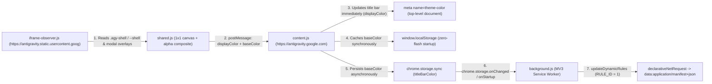

# Technical Documentation — Title Bar Theme for Google Antigravity

This document explains **what** is implemented in `chrome-extension-theme-for-antigravity`, **how** the extension coordinates across origin boundaries and startup phases, and **why** each architectural decision was made.

## 1. Problem Statement — Why a Simple Content Script Isn't Enough

On Windows, Chromium paints a standalone Progressive Web App (PWA) window's title bar and launch splash screen from two signals:

- **Cold launch / splash screen:** `theme_color` and `background_color` inside the Web App Manifest (`/assets/manifest.json`) fetched when the PWA starts.
- **Live window title bar:** `<meta name="theme-color">` in the **top-level document `<head>`**. `<meta name="theme-color">` tags placed inside nested `<iframe>` elements are ignored by Chromium.

In `https://antigravity.google.com/`, four platform constraints prevent a single-script `<meta>` update from working reliably:

1. **Hardcoded `#1f1f1f` Outer Shell:** Both the outer HTML `<head>` (`<meta name="theme-color" content="#1f1f1f">`) and `/assets/manifest.json` (`"theme_color": "#1f1f1f"`) serve a static dark gray value regardless of user preferences.
2. **Cross-Origin UI Iframe (`https://antigravity.static.usercontent.goog/*`):** The actual Antigravity IDE/Remote Control workspace, `.agy-shell`, Appearance theme variables (`--shell`), and modal dialogs render inside a full-viewport cross-origin `<iframe>`. Browser Same-Origin Policy (SOP) blocks top-level document scripts from reading iframe styles/DOM and blocks iframe scripts from mutating the outer document's `<head>`.
3. **CSS Color 4 Expressions & Semi-Transparent Modal Scrims:** Theme surfaces and overlays use modern CSS Color 4 syntax (`oklab(...)`, `color(srgb ...)`) and semi-transparent backdrops (`30%` alpha scrims). Chromium's title bar requires a flat opaque color, so translucent overlays must be resolved and alpha-composited onto the underlying header RGB in JavaScript.
4. **Startup & Cold-Launch Flash:** Reading `chrome.storage` asynchronously or waiting for the cross-origin iframe to mount causes a visible `#1f1f1f` title bar flash before settling on the user's true theme color.

## 2. Architecture & Repository Layout

### Tracked Repository Layout

```text
chrome-extension-theme-for-antigravity/
├── .agents/
│   └── rules/
│       └── rules-git.md            # Git commit identity rules
├── assets/
│   ├── icon16.png                  # Extension icons
│   ├── icon48.png
│   ├── icon128.png                 # Chrome Web Store listing icon
│   └── screenshot-1280x800.png     # Chrome Web Store listing screenshot (excluded from .zip)
├── docs/
│   ├── privacy.md                  # Privacy policy (Markdown)
│   ├── privacy.md.html             # Privacy policy (Standalone HTML)
│   ├── technical.md                # Technical documentation (Markdown)
│   └── technical.md.html           # Technical documentation (Standalone HTML)
├── src/
│   ├── background.js               # MV3 service worker: declarativeNetRequest & tab re-injection
│   ├── content.js                  # Top-level document controller: zero-flash cache & <meta> lock
│   ├── iframe-observer.js          # Cross-origin iframe observer: --shell & modal scrim detector
│   └── shared.js                   # Shared guards, 1x1 canvas color resolver, alpha blender & DOM helper
├── build.ps1                       # Packages CWS-ready .zip archive into dist\
├── manifest.json                   # Extension Manifest V3 (kept at root for Load unpacked)
├── readme.md                       # Non-technical project overview (Markdown)
└── readme.md.html                  # Non-technical project overview (Standalone HTML)
```

**Why `manifest.json` stays at the repository root:** Chrome's `chrome://extensions` → **Load unpacked** requires `manifest.json` directly inside the selected folder and forbids `../` parent path traversal in extension URLs. Keeping [`manifest.json`](../manifest.json) at the root allows immediate developer-mode loading straight from the cloned repository without an extra staging step, while keeping source files under `src/`, media under `assets/`, and documentation under `docs/`.

### End-to-End Signal Flow



## 3. Component Implementation & Design Rationale

### 3.1 Shared Color & DOM Utilities ([`src/shared.js`](../src/shared.js))

Injected into both the top-level document, the child iframe, and imported via `importScripts('./shared.js')` in the service worker to keep constants, color math, and DOM mutation logic unified:

- **Idempotent Runtime Guards & Orphan Teardown (`claimRuntimeGuard`, `isContextValid`):**
  - `claimRuntimeGuard(flagName)` stores `chrome.runtime.id` on `globalThis[flagName]`. If `onInstalled` re-injects scripts in the same extension runtime, duplicate injections exit immediately. Conversely, when the extension updates or reloads in Developer Mode, stale content scripts from the previous runtime receive `isContextValid() === false` (`chrome.runtime.id` becomes inaccessible), triggering `teardown()` to disconnect `MutationObserver` and remove event listeners cleanly.
- **CSS Color 4 Rasterization (`resolveOpaqueRgb`, `parseCssColorWithAlpha`):**
  - Fast regex paths handle `#RRGGBB` and `rgb()`/`rgba()` directly.
  - For modern CSS Color 4 expressions (for example `oklab(0 0 0 / 0.3)` or `color(srgb ...)`), `parseCssColorWithAlpha` extracts trailing `/ alpha` percentages/decimals and passes the opaque color expression to a lazy `1×1` 2D `<canvas>` context (`{ willReadFrequently: true }`). Using Chromium's native canvas CSS parser guarantees bit-accurate sRGB resolution across any future CSS color space without bundling a color conversion library.
- **Alpha Scrim Blending (`blendOverlayOntoBase`):**
  - Standard source-over compositing computes the exact opaque `#rrggbb` title bar color matching a translucent modal backdrop over the header:

$$C_{\text{out}} = \text{round}\!\left(\alpha \cdot C_{\text{overlay}} + (1 - \alpha) \cdot C_{\text{base}}\right)$$

- **Non-Looping `<meta>` Enforcement (`applyThemeColorMeta`):**
  - Checks whether a single `<meta name="theme-color">` tag with the target `content` and no `media` attribute already exists, returning early when synchronized so modifying the `<head>` never triggers an infinite `MutationObserver` cycle.
  - When out of sync, mutates the first tag in place, strips any `media` attribute (so page-level `prefers-color-scheme` meta rules cannot override the calculated color), and removes duplicate tags.

### 3.2 Cross-Origin UI Observer ([`src/iframe-observer.js`](../src/iframe-observer.js))

Runs in `https://antigravity.static.usercontent.goog/*` (`all_frames: true`, `run_at: "document_start"`):

- **Base Header Detection (`resolveBaseShellRgb`):**
  - Reads computed `backgroundColor` on `.agy-shell`, falling back to inline `--shell` on `document.documentElement`. This handles all four built-in theme presets as well as custom colors configured under **Settings → Appearance**:

| Theme | Contrast | Base Header Color (`--shell`) | Settings / Modal Open (`30%` Scrim) |
| :--- | :--- | :--- | :--- |
| **Light** | Default Contrast | `#fafafa` (`rgb(250, 250, 250)`) | `#afafaf` (`rgb(175, 175, 175)`) |
| **Light** | Strong Contrast | `#f3f3f3` (`rgb(243, 243, 243)`) | `#aaaaaa` (`rgb(170, 170, 170)`) |
| **Dark** | Default Contrast | `#111114` (`rgb(17, 17, 20)`) | `#0c0c0e` (`rgb(12, 12, 14)`) |
| **Dark** | Strong Contrast | `#121216` (`rgb(18, 18, 22)`) | `#0d0d0f` (`rgb(13, 13, 15)`) |

- **Three-Tier Modal Overlay Detection (`detectActiveOverlay`):**
  1. **Settings Modal (`.settings-modal-backdrop`):** Filters out hidden or fading-out backdrops (`aria-hidden="true"`, `.animate-modalFadeOut`, `.pointer-events-none`, `display: none`, `visibility: hidden`). In narrow/full-bleed responsive mode (`top <= 1`, `width >= vw - 2`, `height > 100`), `.settings-modal-container` fills the top edge directly, so its opaque surface (`a = 1`) is used; otherwise the backdrop scrim alpha (`~0.3`) is parsed and composited.
  2. **Base UI Modals, Drawers & Popovers:** Inspects `[data-testid="modal-backdrop"]`, `.aux-drawer-backdrop`, `.bg-overlay-default`, and `[data-testid="side-panel-popover"] > div`, skipping exit transitions (`[data-ending-style]`) and confirming top-edge coverage (`top <= 2`, `width >= 0.8 * vw`, `height >= 40`).
  3. **Top-Edge Hit-Test Fallback (`document.elementsFromPoint`):** Samples `y = 8` above `.agy-shell` (`width >= 0.8 * vw`, `height >= 0.8 * vh`, `0.05 <= a < 0.99`) to catch any future full-window overlay selectors without hardcoding class names.
- **Observer Coalescing (`scheduleCheck`):**
  - Observes `document.documentElement` for `childList`, `subtree`, and style/state attributes (`style`, `class`, `aria-hidden`, `data-ending-style`, `data-agy-theme`, `open`, `data-state`), running both an immediate pass and one coalesced `requestAnimationFrame` pass so next-paint CSS transitions settle cleanly.
- **Why `displayColor` and `baseColor` Are Separated:**
  - `window.top.postMessage({ __agTitleBarExt: true, displayColor, baseColor }, 'https://antigravity.google.com')` sends both values. `displayColor` drives the live title bar immediately (including dimmed states), while only undimmed `baseColor` is persisted to storage. That ensures closing Antigravity while Settings or a modal is open never poisons the startup splash color on the next launch.

### 3.3 Top-Level Document Controller & Zero-Flash Startup ([`src/content.js`](../src/content.js))

Runs on `https://antigravity.google.com/*` at `run_at: "document_start"`:

- **Zero-Flash Synchronous Paint (`detectFallbackHostColor`):**
  - Executes before `<head>` finishes parsing. Reads `window.localStorage['__ag_title_bar_color_cache__']` synchronously and applies `<meta name="theme-color">` immediately.
  - On first launch before cache exists, derives the starting preset from Antigravity's native host `localStorage` keys (`bcsp` for Light/Dark and `*.jetski.contrast === '2'` for Strong Contrast) and `body.dark-theme` / `body.dark`.
- **Origin-Validated Capture Listener (`onWindowMessage`):**
  - Registers in the capture phase (`useCapture = true`), verifies `event.origin === 'https://antigravity.static.usercontent.goog'`, validates 6-digit `#RRGGBB` payloads, calls `event.stopImmediatePropagation()` so page scripts never observe extension bridge traffic, and falls back to host theme state if the child `<iframe>` unmounts (e.g., returning to the project picker).
  - Actively sends `{ __agTitleBarExtRequest: true }` at `DOMContentLoaded` and `load` to handle race conditions where the iframe initializes before the parent listener attaches.

### 3.4 Service Worker & Manifest Redirect ([`src/background.js`](../src/background.js))

Runs as the Manifest V3 extension service worker:

- **Dynamic Manifest Override (`declarativeNetRequest`):**
  - Reads `titleBarColor` from `chrome.storage.sync` (default `#fafafa`) and installs dynamic rule `RULE_ID = 1` matching `https://antigravity.google.com/assets/manifest.json*`.
  - Redirects the request to an inline `data:application/manifest+json;charset=utf-8,...` URI mirroring Antigravity's original manifest metadata (`short_name`, `name`, `start_url`, `icons`, `display: "standalone"`) with `background_color` and `theme_color` set dynamically to `titleBarColor`.
  - Why `declarativeNetRequest`? Chrome caches and consults the Web App Manifest when opening a standalone PWA window before any DOM content script executes. Rewriting `/assets/manifest.json` at the network layer guarantees the cold-launch splash screen matches the user's persisted theme.
- **Zero-Reload Activation (`reinjectOpenTabs`):**
  - On `chrome.runtime.onInstalled`, queries open `https://antigravity.google.com/*` tabs and runs `chrome.scripting.executeScript` in both the top-level document (`shared.js` + `content.js`) and child iframes (`shared.js` + `iframe-observer.js`), activating updates immediately without requiring a manual tab refresh.

## 4. Permissions & Security Model

Defined in [`manifest.json`](../manifest.json) under the principle of least privilege:

| Permission / Host | Purpose | Why Broader Access Is Avoided |
| :--- | :--- | :--- |
| `storage` | Persists only `titleBarColor` (`#rrggbb`) in `chrome.storage.sync` so `background.js` can update the manifest redirect rule across browser restarts. | No user profile, browsing history, or page data is stored. See [`privacy.md`](./privacy.md). |
| `declarativeNetRequest` | Installs `RULE_ID = 1` redirecting `/assets/manifest.json*` to a localized `data:application/manifest+json` URI with updated `theme_color` / `background_color`. | Avoids blocking `webRequest` interception while preserving offline-instant redirect evaluation inside Chromium. |
| `scripting` | Re-injects scripts into open Antigravity tabs inside `onInstalled` so updates apply immediately without page reload. | Scoped strictly to matched `host_permissions` origins; `tabs` permission is unnecessary and omitted. |
| `https://antigravity.google.com/*` | Hosts the top-level document controller (`content.js`) and `/assets/manifest.json` redirect rule. | Prevents injection on any other Google domain or external site. |
| `https://antigravity.static.usercontent.goog/*` | Hosts the UI iframe observer (`iframe-observer.js`). | Strictly limited to the exact sandboxed UI origin used by Antigravity. |

## 5. Build Packaging & Automated Provisioning

### Extension Packaging ([`build.ps1`](../build.ps1))

Running `.\build.ps1` validates every icon and script referenced in [`manifest.json`](../manifest.json), appends all runtime files under `src/`, and writes `dist\chrome-extension-theme-for-antigravity-v<version>.zip` (`8` entries) with normalized forward-slash (`/`) ZIP paths required by the Chrome Web Store upload validator. Non-runtime files (`assets/screenshot-1280x800.png`, `docs/*`, `readme.md*`) are intentionally excluded from the archive.

### Automated Policy Provisioning (`powershell-software-installer`)

Chrome Web Store Extension ID `gffpamdcddmdbeljekjlpaknpmjlglni` is configured in the sibling [`powershell-software-installer`](../../powershell-software-installer/readme.md) bundle (`winget_google_antigravity_remote_control`) alongside the Antigravity Chrome PWA:

- Writes Chrome Enterprise Policy `HKLM:\SOFTWARE\Policies\Google\Chrome\ExtensionSettings` for `gffpamdcddmdbeljekjlpaknpmjlglni` with `installation_mode = "normal_installed"` and `update_url = "https://clients2.google.com/service/update2/crx"`.
- **Why this works cleanly on unmanaged machines:** Chromium's `FilterSensitiveExtensionSettings` policy filter permits `normal_installed` on non-domain-joined Windows machines whenever `update_url` points to Chrome Web Store (`clients2.google.com`) and the extension visibility is Public or Unlisted. Using `normal_installed` automatically provisions the extension on fresh machine setups while still allowing end users to disable or uninstall it freely.
