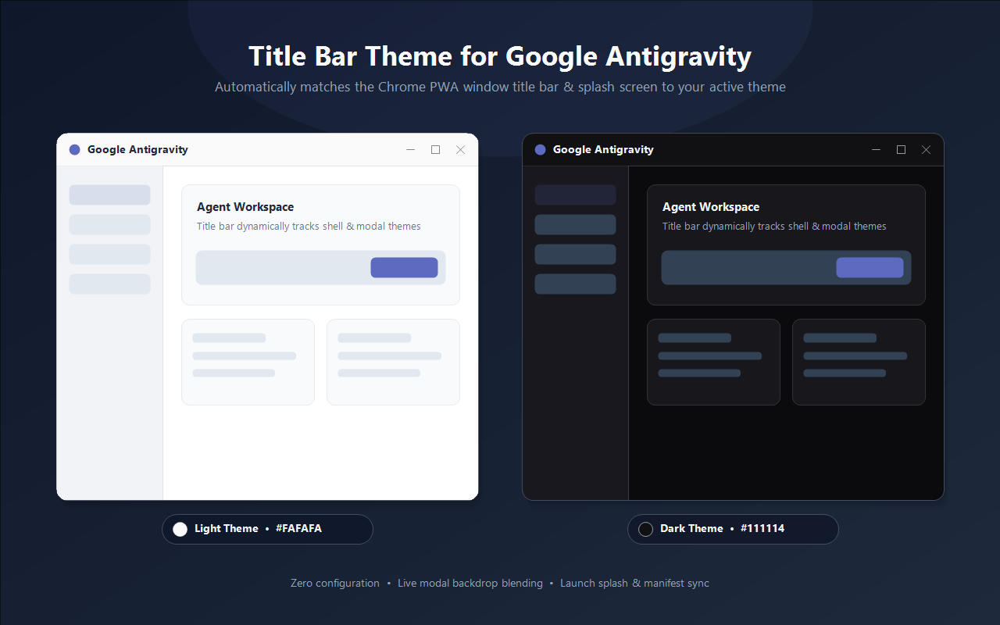

# Title Bar Theme for Google Antigravity

Matches the window title bar and startup screen of the [Google Antigravity](https://antigravity.google.com/) standalone Chrome app on Windows to your active workspace color theme.

## Preview

## Why It Exists

By default, Google Antigravity's web app hardcodes a dark-gray window title bar and launch splash screen even when you switch to Light mode, enable Strong Contrast, pick a custom theme in **Settings -> Appearance**, or open a dimmed modal dialog.

Once installed in Chrome, this extension updates the window title bar and startup screen automatically with nothing to configure, and dims the bar smoothly whenever Settings, drawers, or pop-up dialogs open.

> [!NOTE]
> Window title bar coloring applies to standalone Chrome app windows (created via Chrome's menu **⋮ -> Cast, save, and share -> Install page as app...**). Regular Chrome browser tabs use Chrome's normal tab strip.

## Installation

1. Install **[Title Bar Theme for Google Antigravity](https://chromewebstore.google.com/detail/gffpamdcddmdbeljekjlpaknpmjlglni)** from the Chrome Web Store, or clone this repository for local setup.
2. For a local copy, open `chrome://extensions/`, turn on **Developer mode**, click **Load unpacked**, and select this repository's root folder (containing `manifest.json`).
3. Open **Google Antigravity** (`https://antigravity.google.com/`) in its standalone Chrome app window—the title bar updates automatically with nothing to configure.

## Companion Projects

| Extension | Target App | What It Synchronizes |
| :--- | :--- | :--- |
| **[Title Bar Theme for Google Antigravity](https://github.com/tbruneel/chrome-extension-theme-for-antigravity)** *(this repo)* | [Google Antigravity](https://antigravity.google.com/) | Light/Dark, Default/Strong Contrast, custom Appearance themes, modal/drawer scrims, and PWA launch splash. |
| **[Title Bar Theme for Chrome Remote Desktop](https://github.com/tbruneel/chrome-extension-theme-for-remote-desktop)** | [Chrome Remote Desktop](https://remotedesktop.google.com/) | Light/Dark theme, PIN and settings dialog scrims, and PWA launch splash. |

## Documentation

- [Technical Documentation](./docs/technical.md) — Cross-origin theme detection, modal scrim compositing, PWA manifest redirect, permissions, and packaging.
- [Privacy Policy](./docs/privacy.md) — Local-only theme detection with zero network requests or data collection.
